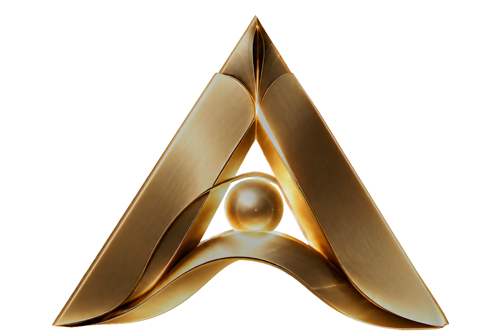

# AccuMedic 3D Logo Studio

High-fidelity 3D reconstruction and interactive WebGL showcase of the approved **AccuMedic** logo emblem.



## Features
- **Faithful 3D Sculpt**: Precision organic ribbons with gothic apex ridge and central golden orb.
- **Ultra-Smooth Metallic Finish**: Mirror-like champagne gold PBR shading without surface grain.
- **Interactive Web Studio**:
  - Continuous 360° slow rotation in the viewport center.
  - Studio 3-point lighting + real-time PMREM HDR reflection environment.
  - Floating luxury glass controls: rotation speed, light warmth, shine, camera presets.
  - One-click **Export GLB** and **Render PNG**.
- **Self-Contained Asset**: Standard production GLB (`AccuMedic_Logo_3D.glb`) compatible with Blender, Unreal Engine, Maya, Windows 3D Viewer, and Three.js.

## Getting Started

### Prerequisites
- Node.js (v18+)
- Python (3.10+)

### Run Locally

1. **Start the Interactive 3D Studio**:
   ```bash
   npm install
   npm run dev
   ```
   Open [http://localhost:5173/](http://localhost:5173/) in your browser.

2. **Rebuild the 3D GLB Model (Optional)**:
   ```bash
   .\.venv\Scripts\python scripts/build_glb.py
   ```

3. **Build for Production**:
   ```bash
   npm run build
   ```
   The compiled static files will be in `dist/`, ready for instant deployment to Vercel, Netlify, or GitHub Pages.

## Project Structure
```
├── AccuMedic_Logo_3D.glb          # Production 3D GLB asset
├── AccuMedic Golden A Emblem Logo.png # Approved reference logo
├── AccuMedic_3D_Reconstruction.png # High-resolution 2D render
├── preview_perspective_3d.png     # 3D angle perspective render
├── index.html                     # Luxury web showcase HTML
├── src/
│   ├── main.js                    # Three.js WebGL engine & lighting
│   └── style.css                  # Glassmorphic luxury UI styling
├── public/                        # Static runtime assets
├── scripts/
│   ├── build_glb.py               # 3D asset generator
│   └── render_3d_angles.py        # Offline multi-angle renderer
├── package.json
└── requirements.txt
```
